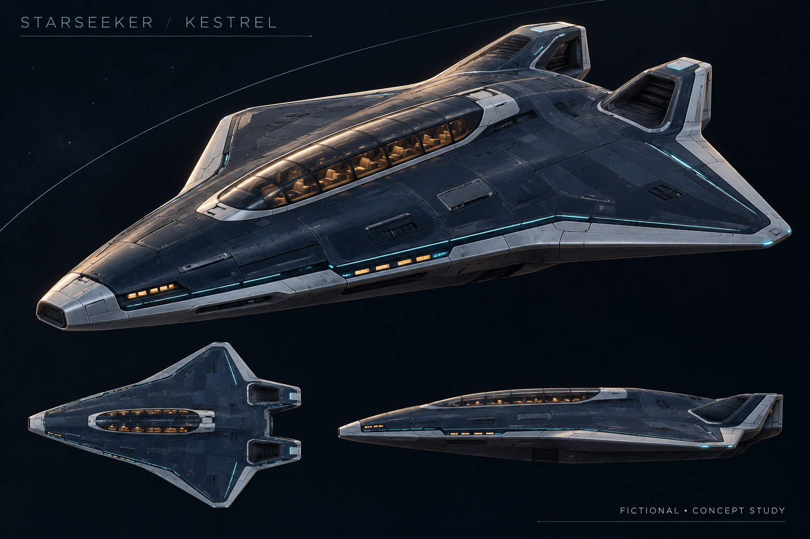
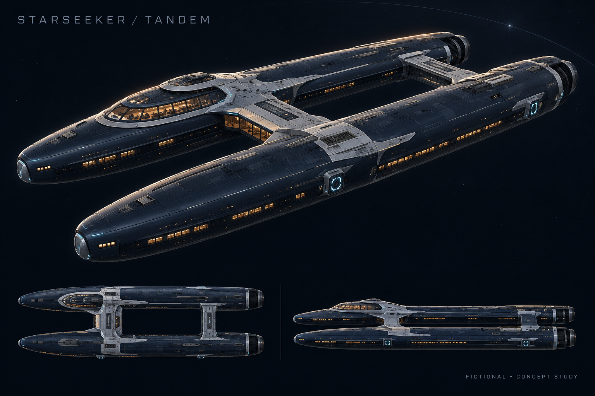
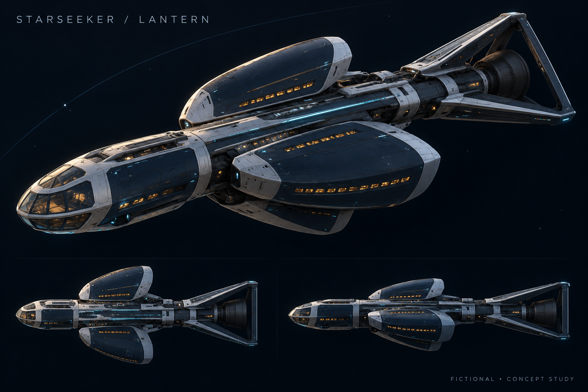
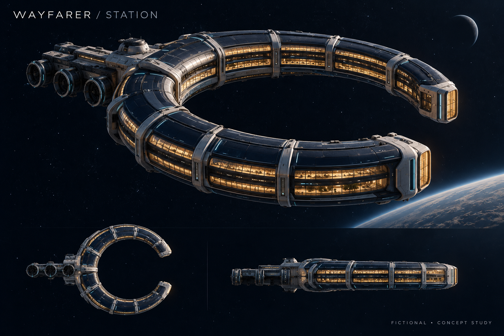

# Starfare — quiet passage through Dark SOL

17 October 2026 · Art direction study · Fictional concepts, not approved production assets

**Game-asset follow-up:** [Four GLB models, twenty transparent PNGs and a standalone rotatable preview](game-assets-v1/README.md) are now available. These preserve the concept silhouettes as a simplified first modeling pass; the original paintings below remain the detailed visual reference. [Download the package](starfare-game-assets-v1.zip).

**Recommendation: develop Tandem first, paired with Wayfarer.** The twin hulls and open center give Tandem a recognizable passenger-travel identity. Kestrel is the simpler compact alternative; Lantern offers a more architectural silhouette but needs the most refinement. This pass stops at concepts and specifications, before a full asset set.

## Review the four concepts

| Concept | Visual idea | Main refinement needed |
|---|---|---|
| [Kestrel](starseeker-01-kestrel.png) | Compact delta shuttle; raised passenger lounge | Soften aircraft/fighter associations; simplify hull seams |
| [Tandem](starseeker-02-tandem.png) | Twin hulls and open central court; recommendation | Resolve bridge geometry and consistent alternate views |
| [Lantern](starseeker-03-lantern.png) | Three passenger pods on a spine; triangular tail frame | Clarify pod count and overlap in every view |
| [Wayfarer](wayfarer-station.png) | Open C concourse with an offset service spine | Resolve service-spine placement; simplify lower-detail version |

## Direction and handoff

- [Art direction and asset specifications](art-direction.md)
- [Motion and recorded-data rules](motion-spec.md)
- [Exact generation prompts](generation-prompts.md)
- [Inspection record](inspection.md)

Built-in image generation produced four separate 1536 × 1024 PNG plates. The generated previews were visually inspected; workspace copies were verified byte-for-byte by SHA-256. All images carry “FICTIONAL • CONCEPT STUDY.” These are flattened concept paintings, not transparent sprites, editable models, accurate orthographic drawings or a measured spacecraft specification. Window counts, visible seats, proportions and backgrounds establish no capacity, scale, performance or scientific claim.

The image plates include decorative cyan lighting and warm cabin light. Those marks are aesthetic studies, not current flight state. Engines are unlit. Wayfarer's planetary backdrop is invented illustration, not real ephemeris or a verified location.

## Context reviewed

Read-only review of Design's 2026-10-17 variants README, comparison.png, and saved design audit in `C:\Users\PC-AIMPANG\Documents\New project 3\.worktrees\starfare-design-audit\docs`. Orbital Desk is Design's recommendation; the final interface remains unselected. The art uses the shared Dark SOL palette and stays independent of all three layouts. Design's SVG study glyphs were not reused or treated as approved brand assets.

Preserved: website observes; MCP-connected agents dispatch. Mobile prioritizes Bookings + compact activity. Default activity contains agent + simulation events; local previews stay excluded. Art makes no vendor-affiliation claim or xAI-key requirement.

Next: choose the ship direction and interface, then refine a consistent model sheet and separate effect layers. Integration remains gated on PR #13 and the interface decision. Design owns layouts/accessibility/transitions; Engineering owns flight state, time, routes and replay. This pass changed only its own art folder, with no app edits, commits, deployment, installation, dispatch or external paid generation. No background servers or helpers were started or retained.
