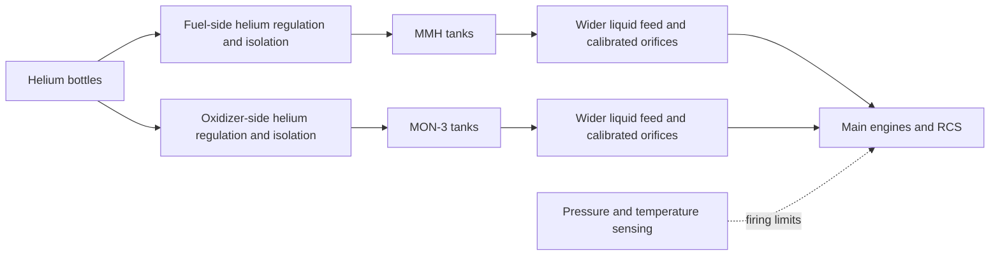

# Option B: proposed feed-pressure fix

## Result for review

**Propose separate helium regulation, wider liquid lines, calibrated engine orifices and measured pressure/thermal firing limits.** The pressure/flow calculations fit the stated requirements for the three local concepts. Exact regulator hardware, thermal continuity and delivered thrust/Isp remain unverified. This is a requirements and mass-budget proposal; fleet and production physics are unchanged.

| Updated concept | Cargo, in addition to occupants | Dry design mass | Loaded MMH + MON-3 | Departure mass |
|---|---:|---:|---:|---:|
| Courier S, uncrewed | **40 kg** (previously 70) | 400.33 kg | 289.74 kg | 745.17 kg |
| Courier M, uncrewed | **420 kg** (previously 450) | 473.07 kg | 567.76 kg | 1479.78 kg |
| Cabin, two occupants | **150 kg** | 1424.51 kg | 1125.97 kg | 2950.97 kg |

Arrival envelopes remain 500/1000/2000 kg, with 40% dry hardware growth, 10% burn contingency, independent 100 m/s ideal RCS inventory and 1% unusable liquid. These remain conditional proposals for the proposed Phobos pad to Mars orbital station, not Mars surface flights. No docking, abort, return, human qualification or full vehicle terrain clearance is established.

## What caused the gap

The earlier warm tank screen reaches 20.75 bar, while the engine sheet lists 12.5–18.5 bar inlet. A maximum allocated 3 bar feed loss cannot be treated as a guaranteed reduction, especially at low or zero flow. A helium regulator adds gas when pressure falls; it cannot remove pressure already trapped by warming. Fixed orifices also do not regulate the whole zero/pulse/main-engine flow range.

The [manufacturer supplies engine trimming orifices for calibration to system design pressure](https://www.space-propulsion.com/spacecraft-propulsion/apogee-motors/index.html). This supports system calibration as a design step; it does not prove 425 N/321 s throughout the published pressure interval. The [main/RCS engine sheet](https://www.ariane.group/app/uploads/2024/09/ArianeGroup_Chemical_Bipropellant_Thruster_Family.pdf) provides flow and mixture ranges used below.

## Proposed arrangement



The liquid paths remain separate. This proposal uses no downstream liquid regulator and introduces no venting. Isolation/check arrangements, fail-open protection, gas/vapor compatibility, trapped-liquid expansion and transient response need specific hardware evidence.

### Quantified operating requirements

- **Measured tank firing window: 15.5–17.5 bar absolute**, with 0.10 bar sensor error and +/-0.25 bar transient allocations. Condition gas to at least 10 C; maintain the demonstrated pressure envelope throughout every scheduled burn. Temperature control and electrical heat rejection are not yet sized to prove that continuity.
- **Two helium regulator paths:** each must regulate/control at 16–16.5 bar absolute, limit normal lockup to 16.5 bar at the control condition, tolerate at least 22 bar downstream MEOP, and deliver **1.25 g/s at 30 bar inlet**, across the required 30–310 bar inlet and temperature envelope. Thermal pressure in isolated storage is a separate condition, not regulator lockup.
- **Liquid geometry:** each fluid has a 2 m, 14 mm internal-diameter header; four 1 m, 6 mm main branches; twelve 2 m, 4 mm RCS branches. These are proposed internal dimensions, not selected flight tubing or a verified layout.
- **Preliminary loss assumptions:** Darcy friction factor `max(0.06,64/Re)`, viscosity bound 0.002 Pa s, header/branch minor-loss coefficients 8/4, and 0.25 bar fixed PMD/filter loss. Apply 4% warm liquid expansion when converting mass flow to volume flow. Actual line roughness, fittings, valves, PMD behavior, viscosity and single-phase flow need measurement.
- **Signed acceleration head:** allow up to 5 m along the acceleration direction, using maximum catalog thrust and mass after all usable reserves. This bounds pressure increases as well as decreases; a full vehicle geometry must confirm the 5 m allocation.

The worst fluid-path loss is **1.206 bar** in the model. For the selected combined conservative budgets, adding the assumed sensor/transient/acceleration bounds gives:

| Concept | Acceleration-head allowance | Conditional engine inlet interval, absolute |
|---|---:|---:|
| Courier S | +/-0.298 bar | **13.646–18.148 bar** |
| Courier M | +/-0.149 bar | **13.795–17.999 bar** |
| Cabin | +/-0.074 bar | **13.870–17.924 bar** |

The engine table labels its range simply as **bar**, without an explicit reference convention. The calculator provisionally checks both absolute and gauge-relative-to-standard-atmosphere interpretations (1.01325 bar offset); these three intervals fit both. Supplier confirmation of the convention remains required. This comparison establishes neither calibrated thrust nor transient stability.

Storage remains independently screened at **30 C**, using the previous per-tank helium/liquid expansion and assumed vapor/transient allowances. The 20.75 bar warm tank condition is outside this proposal's firing window. Cooling/conditioning must establish the operating window before launch and sustain it through capture; a pressure interlock can refuse a burn but cannot make the accepted trajectory survive a shutdown. Any interruption, changed thrust/Isp or extra burn requires trajectory replanning.

### Flow requirement and source checks

Six deterministic flow conditions are evaluated: zero, one RCS pulse's steady bound, all RCS at maximum, nominal main, maximum main, maximum main plus all RCS. This is a static requirement calculation, not a pulse/transient simulation. Catalog mixture extrema bound each fluid independently; the two maxima are not a simultaneous nominal mixture point.

| Per-fluid worst case | MMH | MON-3 |
|---|---:|---:|
| Maximum mass flow | 0.25011 kg/s | 0.39928 kg/s |
| Warm volume flow | 0.30602 L/s | 0.29661 L/s |
| Helium delivery including 25% flow allowance | **1.18581 g/s** | **1.14937 g/s** |

For this flow screen, [NIST real-helium data](https://webbook.nist.gov/cgi/fluid.cgi?Action=Data&Wide=on&ID=C7440597&Digits=6&RefState=DEF&TUnit=K&PUnit=bar&DUnit=kg%2Fm3&Type=IsoTherm&T=283.15&PLow=18.35&PHigh=18.35&PInc=1) give 3.09118 kg/m3 at 18.35 bar and 10 C; use a 3.1 bound conditional on gas remaining at least 10 C and pressure below that reference. Colder unconditioned gas invalidates this bound. The original inventory remains at its separately pinned 16.5 bar / 10 C state, with its 15% inventory-delivery allowance; a 25% instantaneous-flow allowance is a different requirement.

**No exact catalog regulator match was established.** [Moog's published regulator page](https://www.moog.com/products/propulsion/space-propulsion/spacecraft-propulsion/propulsion-components/helium-regulator-pneumatic-pressure-regulator.html) distinguishes a 2500 psia inlet unit, unsuitable for the existing 250 bar charge, from the 331 bar 50X1463 reference. The latter lists 1.8 kg mass, 0.91 g/s at minimum inlet and a higher outlet setting; its page also describes development status. It cannot be claimed to meet this requirement. The 3.6 kg pair below is an estimate referenced to that published mass, not a selected part.

[Stanford Mu's series helium regulator](https://stanfordmu.com/feature-works/) publishes up to 2.5 g/s and less than 1.13 kg, but its outlet range is expressed in psig and starts near 17.56 bar absolute. Its quoted varied-flow accuracy example covers only 0.1–0.6 g/s. Those statements do not establish the proposed setpoint, accuracy or lockup at the required flow. Low-flow xenon/nitrogen regulator specifications are not substituted for chemical-system helium requirements.

## Updated complete mass budgets

Replace the former generic common-feed row once. Retain its original **20/25 kg** as isolation, filtration, manifolds and integration reserve, with no credit for its earlier unspecified regulator content. Add these explicit **net bare estimates**, then apply growth:

| Added allocation | Bare mass |
|---|---:|
| Two custom helium regulator units | 3.6 kg |
| Pressure/temperature sensing and control | 1.4 kg |
| Larger-line / orifice integration upgrades | 3.0 kg |
| Additional thermal conditioning equipment | 8.0 kg |
| **Net bare increment** | **16.0 kg** |
| **Increment including 40% growth** | **22.4 kg** |

This is a conservative design allocation, not a qualified bill of materials or thermal/power capacity claim. Original tank shells, mounts, branch integration, engines, cabin and other component allocations remain in the [detailed original ledger](OPTION-B-SHIP-BUDGETS.md#every-dry-hardware-allocation). The proposed tank banks remain 1/2/4 OST21-235 per fluid, with 1/2/3 PVG50 helium bottles respectively.

| Mass, kg | Courier S | Courier M | Cabin |
|---|---:|---:|---:|
| Dry hardware before growth | 285.952 | 337.904 | 1017.508 |
| Dry growth, 40% | 114.381 | 135.162 | 407.003 |
| **Dry design** | **400.333** | **473.065** | **1424.511** |
| Nominally burned liquid | 245.170 | 479.783 | 950.971 |
| Unspent contingency | 24.517 | 47.978 | 95.097 |
| Unspent ideal RCS inventory | 17.160 | 34.319 | 68.638 |
| Unusable residual liquid | 2.897 | 5.678 | 11.260 |
| **Loaded liquid, sum of preceding four liquid rows** | **289.744** | **567.758** | **1125.966** |
| All retained helium | 2.438 | 4.893 | 7.964 |
| People and suits | 0 | 0 | 200.000 |
| Provisions / cabin air | 0 | 0 | 34.120 |
| Cargo | 40.000 | 420.000 | 150.000 |
| Additional trim/ballast | 12.656 | 14.066 | 8.410 |
| **Departure total** | **745.170** | **1479.783** | **2950.971** |
| **Arrival after nominal burn** | **500.000** | **1000.000** | **2000.000** |

Subtotal rows are not additional mass. The additional retained helium is **0.011030 kg per ship**: high-pressure line fill, low-pressure line fill and extra tank ullage displaced by liquid already in the wet feed lines. It is accounted inside the fixed arrival mass. The larger stored-gas capacity is conservatively not credited for extra deliverable inventory.

Wet line/component hold-up is **0.82257 L per fluid**, supplied from the existing liquid load; do not add fuel again. At the assumed cold densities it traps at most 0.69918 kg MMH and 1.15159 kg oxidizer, within the smallest concept's 1.09338/1.80407 kg residual allocations. The calculator refuses a proposed line inventory exceeding either residual. Tank selection retains the conservative all-liquid-in-tank thermal/volume upper bound while separately counting the extra initial ullage helium.

These mass/chemical totals preserve the old trajectory envelopes; they do not create newly verified flight times. The saved 141.6/143.4/150.1 minute references apply only if calibrated 1700 N/321 s delivery and continuous scheduled burns can be maintained. Lunar concepts remain overweight under these requirements; adding hardware is not permission to reuse their old normalized trajectories at greater mass.

## Reproduce and next evidence

```powershell
node audit/option-b-ship-budget.mjs --feed-proposal audit/option-b-feed-proposal.json --out audit/option-b-feed-budget.json
```

The original calculator without the flag retains the original study. This run re-evaluates 56 mission/role/policy budget combinations, with six static flow conditions per budget. Repeated calculations are not flight tests or independent statistical trials. Seven source mission reports match the saved accepted reports. Full precision mass errors for selected closed proposals are below 0.000001 kg. No application tests were added or run.

Before applying this proposal to the fleet, obtain the exact regulator configuration and pressure reference; validate hydraulic/transient and single-phase delivery; establish continuous thermal operation and its power budget; calibrate mixture/thrust/Isp at the actual inlets. Without that evidence, status remains **requirements only** and the fleet remains unchanged.

The later [thermal power and revised mass study](OPTION-B-THERMAL-POWER.md) replaces this document's 8 kg thermal placeholder, corrects helium partial-pressure inventory and increases unusable retained propellant allowance. Its conservative proposals are 350 kg medium-courier cargo or two occupants plus 60 kg cabin cargo; the small courier is overweight. The original feed-only calculator remains reproducible. Thermal continuity still requires actual conductance, heat exposure and hardware evidence.
