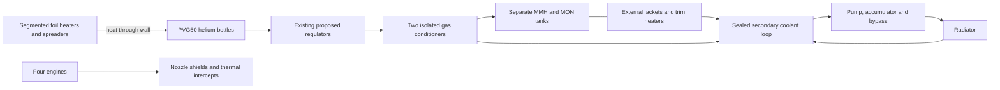

# Option B: heat exposure, proposed hardware and updated budgets

2026-10-18. **No fleet change. Heat exposure and bottle/loop transfer remain unproven.** Public component data establishes useful constraints, but contains no installed four-engine heat map, PVG50 heater-to-gas conductance or qualified loop design for this ship. This investigation replaces the previous 6 kg filled-equipment allowance with an explicit proposed assembly and calculates the missing interface requirements.

## Findings

1. **Engine shutdown is not instant cooling.** Evaluate the existing 0/250/1000 W engine-to-liquid heat sensitivities with a **600 s exponential decay after each cutoff**. The one-kilowatt case adds about **0.600 MJ during coast** and **0.599 MJ during the first hour after capture**, in addition to firing heat. This is a declared sensitivity, not a measured engine thermal time constant or upper bound.
2. **Heater watts do not establish heat delivered to bulk helium.** About 0.88 kW must cross the bottle's heater/contact/composite/liner/gas interfaces during firing. Actual acceleration, gas redistribution and wall response matter. A downstream gas heater cannot supply energy to helium remaining inside the bottle.
3. **The 30 W pump allowance was unsupported.** The narrow temperature interval needs a complete coolant temperature and pressure budget. A proposed **2 kW loop, 6→8 °C coolant and 5 °C radiator** requires about **16.42 L/min**, with a provisional **150 W pump plus 15 W control load**.

## Proposed installed hardware

These are **custom design allowances using identified component classes**, not selected flight-qualified assemblies or manufacturer mass/capacity promises. Keep the existing 1/2/4 OST21-235 tanks per fluid and 1/2/3 PVG50 bottles.



The diagram shows functions and heat/pressurant paths, not a geometric layout. No propellant is recirculated as coolant and no catalog pressure vessel is modified internally.

| Installed item before growth, kg | S | M | Cabin | Candidate class / status |
|---|---:|---:|---:|---|
| Four nozzle shield kits | 8.0 | 8.0 | 8.0 | ArianeGroup accessory class; 2 kg each estimated |
| Added thermal intercept/support integration | 2.0 | 2.0 | 2.0 | Estimate; existing thrust frame retained |
| Bottle heater/spreader/attachment | 2.0 | 4.0 | 6.0 | Minco space-foil heater class; custom installed estimate |
| Separate liquid tank jackets/trim heaters | 2.0 | 4.0 | 8.0 | 1 kg per tank estimate; actual wetted transfer unknown |
| Coolant pump package | 2.0 | 2.0 | 2.0 | AMETEK PDT space-MPFL class; 150 W design requirement |
| Accumulator / bypass-isolation valves / transport pipes | 5.5 | 5.5 | 5.5 | Dry estimates: 1 / 1.5 / 3 kg |
| Four litres retained transport coolant | 4.4 | 4.4 | 4.4 | Fill upper allocation 1.1 kg/L, including accumulator charge |
| Two gas conditioners | 2.0 | 2.0 | 2.0 | Custom 1 kg each estimate |
| Additional thermal sensing/harness / pad HX and disconnects / blankets | 4.0 | 4.0 | 4.0 | Estimates: 1 / 2 / 1 kg |
| **Replacement filled-equipment subtotal** | **31.9** | **35.9** | **41.9** | Replaces the former 6 kg once |
| Filled radiator assembly | 48.250 | 49.061 | 50.707 | Includes panel coolant; 5 kg/m² estimate retained |
| Dedicated complete battery | 15.0 | 19.5 | 28.5 | Pack assumptions from previous study retained |
| Power conditioner | 2.047 | 2.085 | 2.155 | Estimate |
| **Complete added thermal assembly subtotal** | **97.197** | **106.546** | **123.262** | Before growth; do not add subtotal rows again |

Transport coolant excludes panel charge already inside filled radiator mass. Existing tank insulation, bus thermal hardware, feed sensors and electrical allocations remain separately counted; no shared-bus credit. The pad plant is external; only its carried exchanger/disconnect interface is budgeted.

## Required exposure and transfer interfaces

**Engine shielding.** The manufacturer describes film/radiative cooling, chamber-wall capability up to 1600 °C and available heat shields; it provides no installed attenuation for this layout. Using 1600 °C as an assumed hot-source temperature, allocate the one-kilowatt liquid heat sensitivity as 500 W radiation, 250 W solid conduction and 250 W other/penetration/plume contribution. The design must establish:

- `Σ(ε_effective × hot area × view factor) ≤ 0.0007166 m²` for radiation to the modeled liquid nodes, using Stefan–Boltzmann exchange to the target temperature.
- Total hot-to-liquid solid-path conductance **≤0.1573 W/K** for the stated extreme temperature difference.
- Actual plume/backflow, shield reradiation, feeds, openings and local hot spots within their allocation. No shield percentage, standoff material or absent direct plume sightline is accepted as proof. Bottle, regulator, bus and radiator heat exposure also needs its own geometry; the present liquid-only engine sensitivity does not bound those nodes.

Actual hot-surface temperatures, view factors, path temperatures and post-burn stored heat remain missing. These reverse-calculated requirements specify what a layout must achieve; they do not establish what the engines deliver to the ship.

**Bottle heating.** Proposed source/contact region 50 °C → inner wall 40 °C → bulk helium 20 °C, below the PVG50 catalog +60 °C limit. With a 20% local heat-draw allowance, required conductances **per bottle** are:

| Interface requirement, W/K | S | M | Cabin |
|---|---:|---:|---:|
| Inner wall to gas | 52.40 | 26.32 | 17.62 |
| Heater/contact/composite/liner path | 104.79 | 52.63 | 35.25 |
| Equivalent complete source-to-gas path | 34.93 | 17.54 | 11.75 |

The complete path obeys `1/UA_total = Σ(1/UA_interface)`; do not give every interface the entire temperature difference. These values are requirements, with measured values recorded as **null**. Temperature gradients, attachment approval and transient wall/gas response remain open.

In particular, the proposed 50→40→20 °C operating gradient is not an established launch state. The earlier pad-equilibrium assumption does not instantly create a 40 °C wall when withdrawal begins. Wall/spreader heat capacity, startup timing, coast soak and controller response can add power or energy beyond the tabulated controlled-path demand. They are unmodeled, recorded as unknown, and must be reconciled with the pack/margins after hardware selection.

As a diagnostic only, a 50 L equivalent sphere and assumed helium conductivity 0.15 W/m/K need gas-side Nusselt numbers about **243/122/82**. NASA's different Orion COPV model uses approximately 5.9 without acceleration and 540 under its firing conditions. Those values are not a PVG50 correlation or measurement. Our reference firing acceleration ranges from **2.28→3.40 / 1.15→1.70 / 0.58→0.85 m/s²**, so coast and firing must be assessed separately. There is no coast main-engine gas withdrawal in the saved schedule.

**Coolant loop.** A 2 kW capacity at assumed `cp≥3500 J/kg/K` and 2 K rise needs 0.286 kg/s. At density 1043.85 kg/m³, ten metres of 16 mm ID pipe, `K=20`, friction factor 0.06, viscosity allowance 0.008 Pa·s and **40 kPa for all nonpipe components**, calculated drop is **95.62 kPa**. The nonpipe allowance explicitly includes radiator, jacket branches, gas conditioners, valves and manifolds; it is not measured. At 25% wire-to-fluid efficiency the calculation needs **104.7 W**, hence the 150 W allocation. Only **4.38 kPa** remains below the proposed 100 kPa ceiling; a measured system curve is necessary. Reynolds number is approximately 2842, in transition, so the friction input is also unverified.

Pipes hold 2.011 L; another 1.5 L nonpanel component/accumulator allowance gives **3.511 L required**, within the 4 L fill allocation. Actual volumes, coolant compatibility, 6–8 °C properties and pump inlet/accumulator performance remain unqualified. Dow's 30% glycol table supplies nearby 10 °C context; the colder property bounds are assumptions.

The complete temperature interval is shared: minimum tank-to-coolant approach **2.25 K**, cold coolant-to-panel approach **1 K**. Their exchanger log-mean differences are **3.145 K** and **1.820 K** respectively. Required liquid-jacket UA, including 25% capacity margin, is **203/208/216 W/K per fluid**. Screen the radiator's coolant-to-panel interface at **1099 W/K** for the 2 kW transport rating. This is a conservative interface requirement; actual proposed emitting area is sized for **1.60–1.68 kW**, not 2 kW rejection to space. Flow balancing/bypass must establish the assumed temperature profile. Each coolant-coupled gas conditioner needs approximately **45.3 W/K**, using the conservative 2.25 K minimum approach and margin. These capacities are not established by radiator area or heater rating. Inherited direct-to-radiator aggregate UA fields remain reference lower bounds only.

## Recalculated power and complete mass budgets

**Duty:** both saved burns, the coast, and **one hour of onboard conditioning after capture**. Keep coolant pump/control power throughout, then require external conditioning service; thermal/electrical needs do not disappear at handover. The 600 s tail leaves about 2.48 W of modeled engine heat at that endpoint. Pad cooling before launch remains separately required. No reset or reserve expenditure is assumed.

| Thermal subsystem requirement | S reference | M | Cabin reference |
|---|---:|---:|---:|
| Electrical design rating, including 25% margin | 2.047 kW | 2.085 kW | 2.155 kW |
| Output energy, flight + one hour | 896 Wh | 1176 Wh | 1739 Wh |
| Required battery nameplate with derating/margin | 1750 Wh | 2296 Wh | 3397 Wh |
| Radiator rejection design rating | 1.596 kW | 1.623 kW | 1.677 kW |
| Radiator emitting area | 9.65 m² | 9.81 m² | 10.14 m² |

Maximum battery energy comes from the cold, zero-engine-heat sensitivity; the higher engine cases drive rejection capacity. The case set includes both. Existing bus, cabin and engine electrical loads are additional and still need a full system budget. The extra post-capture hour is a declared design duty, not part of the saved flight time.

| Allocated mass, kg | S: rejected | M: conditional proposal | Cabin: rejected |
|---|---:|---:|---:|
| Hardware + retained coolant, before growth | 375.149 | 436.450 | 1132.770 |
| 40% hardware growth allocation | 150.059 | 174.580 | 453.108 |
| **Installed design subtotal** | **525.208** | **611.030** | **1585.878** |
| Nominal propellant consumed | 245.170 | 479.783 | 950.971 |
| Unspent contingency / ideal RCS inventory | 41.677 | 82.298 | 163.735 |
| Unusable retained propellant, including vapor/wet hold-up | 3.484 | 6.827 | 13.539 |
| **Loaded propellant subtotal** | **290.331** | **568.907** | **1128.245** |
| All retained helium | 2.417 | 4.851 | 7.879 |
| People and suits | 0 | 0 | 200.000 |
| Provisions and cabin air | 0 | 0 | 34.120 |
| Cargo | 0 | **290.000** | 0 |
| Additional trim | 0 | 4.994 | 0 |
| **Required departure total** | **817.956** | **1479.783** | **2956.122** |
| **Required arrival total** | **572.786** | **1000.000** | **2005.151** |
| Saved arrival allowance | 500.000 | 1000.000 | 2000.000 |
| **Overweight** | **72.786** | **0** | **5.151** |

Subtotal rows are not additional mass. Working coolant receives the existing filled-hardware growth allocation conservatively. Lower as-built hardware/fluid/gas mass requires real trim or a new trajectory. S/Cabin figures are rejected assemblies: their saved flight times cannot be assigned at these larger totals. M preserves its 1479.783→1000 kg envelope, conditional on the unproven hardware/pressure requirements. This supersedes the earlier 350 kg courier and two-person-plus-60 kg cabin proposals under the new duty/allowances.

**Alternative:** additional warm helium bottles could remove dependence on bottle heating, but require a new real-gas/wall/flow-imbalance/regulator-temperature analysis. The recorded ideal adiabatic diagnostics use `T_final/T_initial=(m_final/m_initial)^(2/3)` and 20% draw sensitivity; they neither select bottle counts nor establish compliance with the −30 °C vessel limit. Do not add bottles or subtract heater power from the old result without recalculating gas, power and mass.

## Reproduce and remaining evidence

```powershell
node audit/option-b-ship-budget.mjs --feed-proposal audit/option-b-feed-proposal.json --thermal-proposal audit/option-b-thermal-proposal.json --thermal-hardware audit/option-b-thermal-hardware.json --out audit/option-b-thermal-hardware-budget.json
```

The optional installed-hardware input leaves prior study modes available. Generated JSON is ignored; sourced inputs, BOM and arithmetic are tracked. Application tests were not added or run. Numerical refinement and prior-mode comparisons are recorded in the design record.

Next evidence is specific: an engine-bay geometry/thermal map including plumes and shutdown soak; supplier-approved PVG50 heater attachment with conductance and gas/strain/temperature response under the actual acceleration/withdrawal profile; and a complete coolant pump/system curve plus jacket/radiator exchanger performance. Exact regulators and delivered engine performance also remain open. **Mass closure is not thermal qualification.**

## Primary references

- [ArianeGroup engine catalog](https://space-propulsion.com/brochures/bipropellant-thrusters/bipropellant-thrusters.pdf) and [accessories](https://space-propulsion.com/spacecraft-propulsion/apogee-motors/index.html): engine thermal/component classes, no installed heat-transfer map.
- [PVG50](https://www.mt-aerospace.de/files/mta/tankkatalog/Datenblatt_PVG-50.pdf): vessel material and operating envelope. [NASA Orion heat/mass transfer paper](https://ntrs.nasa.gov/api/citations/20205004021/downloads/ESM_HMT_Paper_Final.pdf), helium-transfer section: acceleration-dependent gas-side modeling in a different vessel.
- [Minco space heater class](https://www.minco.com/catalog/?catalogpage=product&cid=satellite-heaters&id=HAP6749), [AMETEK PDT space pumped loops](https://www.pd-tech.com/markets/space), [Dow glycol-fluid properties](https://www.dow.com/content/dam/dcc/documents/en-us/productdatasheet/180/180-01315-01-dowfrost-hd-tds.pdf?iframe=true): candidate classes/property context, not our assembly's selected performance or mass.
- [NASA Apollo engine-plume thermal protection report](https://ntrs.nasa.gov/api/citations/19720018272/downloads/19720018272.pdf): plume interactions require layout-specific assessment.
